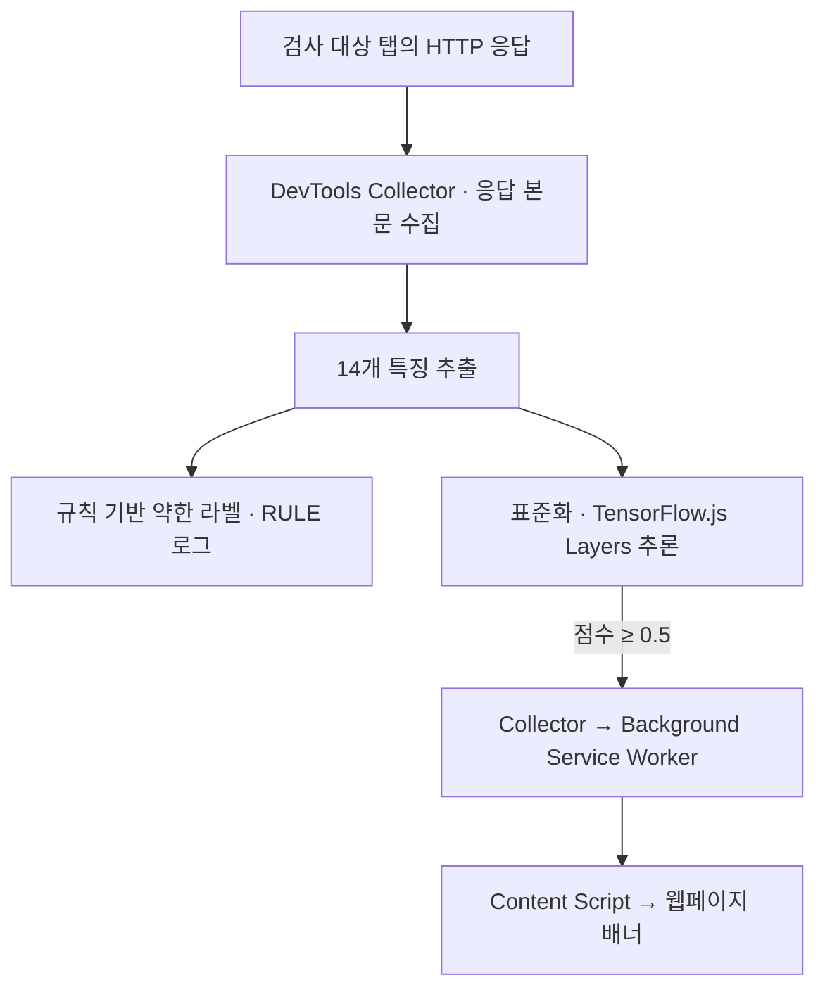

# 웹 트래픽 의심 행동 탐지 시스템

**Behavior-based Suspicious Traffic Detection with ML + Chrome Extension**

Chrome DevTools에서 HTTP 응답 본문을 분석하고, 의심 점수가 임계값에 도달하면 웹페이지에 경고 배너를 표시합니다.

## 주요 기능

- **Collector** — 검사 대상 탭의 HTTP 응답을 수집하고 카운터를 갱신합니다. **Download JSON**으로 저장하고 **Clear**로 초기화한 뒤 다시 수집할 수 있습니다.
- **브라우저 추론** — 응답 본문에서 추출한 14개 특징을 표준화하고, 로컬 TensorFlow.js Layers 모델로 의심 점수를 계산합니다.
- **페이지 경고** — ML 점수가 **0.5 이상**이면 웹페이지에 배너를 표시합니다. URL과 MIME 등은 DOM 텍스트로 표시하며, 배너는 약 6초 후 사라집니다.

<!-- 데모 스크린샷을 추가할 위치. Collector 카운터와 웹페이지 배너가 함께 보이는 Chrome 화면을 사용합니다. -->

## 실행 방법

1. Chrome에서 `chrome://extensions`를 열고 **개발자 모드**를 켭니다.
2. **압축해제된 확장 프로그램을 로드합니다**를 선택하고 프로젝트의 [`extension/`](extension/) 폴더를 지정합니다.
3. 분석할 탭의 DevTools에서 **Collector** 패널을 연 뒤, **그 상태에서 페이지를 새로고침**합니다. 패널 실행 이후 완료되는 응답부터 수집합니다. DevTools 탭 목록에 Collector가 보이지 않으면 오버플로 메뉴를 확인하세요.

확장 폴더에 TensorFlow.js 번들과 모델이 포함되어 있습니다. 코드나 모델 파일을 변경했다면 확장 관리 화면에서 다시 로드하고 DevTools를 다시 여세요.

## 동작 구조

[특징 추출 코드](extension/features.js)는 본문 길이, 줄 수, 문자 비율, Shannon 엔트로피, `eval`·`atob` 등 특정 키워드의 등장 횟수를 계산합니다. Collector는 상태 코드 200–399, 허용된 HTML·JSON·JavaScript MIME, 50자 이상 본문을 기준으로 필터링하고 중복을 제외합니다. RULE 탐지 결과는 로그에 기록되며, 배너는 ML 점수 기준으로 표시됩니다.

## 모델 및 평가 결과

**브라우저**에서는 [TensorFlow.js 4.22.0](extension/tf.min.js)과 [14입력 Layers 모델](extension/model/model.json)을 사용합니다. 모델은 Scaler로 표준화한 14개 특징에서 sigmoid 점수 하나를 출력합니다. 학습 및 내보내기 과정은 [모델 학습 노트북](training/03_model_export_to_h5.ipynb)에 있습니다.

**Python 비교 실험**에서는 [평가 노트북](training/04_random_forest_vs_linear_regression.ipynb)에서 Random Forest와 scikit-learn Logistic Regression을 비교했습니다. 수집 요청 4,046건 중 보관된 506건에 규칙 기반 약한 라벨을 부여했습니다. 그중 정상 라벨은 439건, 의심 라벨은 67건입니다.

| Python 모델 | 의심 클래스 Precision | 의심 클래스 Recall | 의심 클래스 F1 | 약한 라벨 기준 FP |
| --- | ---: | ---: | ---: | ---: |
| Random Forest | 1.000 | 0.857 | 0.923 | 0 |
| Logistic Regression | 0.68 | 0.93 | 0.79 | 6 |

Random Forest는 평가 샘플 102건 중 100건에서 약한 라벨과 일치해 **Weak Labeling 기준 정확도 98.04%**를 기록했습니다. 실제 악성 탐지 성능을 평가하려면 독립적으로 검증한 라벨과 별도의 데이터셋이 필요합니다.

## 프로젝트 구조

| 경로 | 역할 |
| --- | --- |
| [`extension/manifest.json`](extension/manifest.json) | Manifest V3 확장 설정 |
| [`extension/collector.js`](extension/collector.js) · [`features.js`](extension/features.js) | 응답 수집, 카운터, JSON 내보내기, 특징 추출 |
| [`extension/predictor.js`](extension/predictor.js) · [`extension/model/`](extension/model/) | 브라우저 추론, 모델 JSON, 가중치, Scaler |
| [`extension/background.js`](extension/background.js) · [`content_script.js`](extension/content_script.js) | 대상 탭으로 경고 전달, DOM 배너 표시 |
| [`training/`](training/) | 데이터 처리, 모델 학습, Python 비교 실험 |

## 한계 및 개선 방향

- **실행 범위** — Collector를 연 검사 대상 탭의 응답을 분석합니다. 경고는 웹페이지 안에 표시되며, 네트워크 요청을 자동 차단하는 기능은 없습니다.
- **내보내기 데이터** — JSON에는 전체 요청 URL과 응답 본문 앞 최대 200자가 포함됩니다. 공유 전에 쿼리 문자열과 본문 발췌에 민감한 정보가 있는지 확인하세요.
- **평가 범위** — 규칙 기반 라벨과 클래스 불균형의 영향을 받습니다. 독립 라벨로 평가하고, 다양한 사이트의 응답에서 오탐과 미탐을 확인하는 것이 다음 검증 과제입니다.

문의는 GitHub Issues 또는 [이메일](mailto:rkdwl3264@naver.com)로 남겨주세요.
